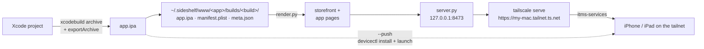

<div align="center">

# Sideshelf

**A personal App Store for your own iOS apps.**
One command builds your Xcode project and installs it over the air on your iPhone or iPad, from anywhere on your tailnet.

**English** · [Русский](README.ru.md)


</div>

```console
$ ota-deploy.sh --push
Building Semafor (com.example.semafor) build 20261003.125425...
Exported Semafor to: build/ota-deploy/export
Published: https://my-mac.tailnet.ts.net/semafor/
Installed and launched on device C0F30EBA-…
```

## Why

Getting a build of your own app onto your own phone is still oddly hard. TestFlight means
uploading, processing and waiting. Ad-hoc builds mean juggling profiles. Running from Xcode means
a cable and a Mac within reach.

Sideshelf skips all of that. It builds a development-signed `.ipa`, puts it on an App Store-style
page served from your Mac over [Tailscale](https://tailscale.com) HTTPS, and you tap "Install" on
the phone, wherever you are. If the Mac can see the device, `--push` installs and launches the app
with no taps at all. It is also a [Claude Code](https://claude.com/claude-code) skill, so "install
it on my phone" at the end of a coding session is enough.

## Demo


<sub>Demo GIF coming soon (`docs/demo.gif`).</sub>

## Features

- **One command.** `xcodebuild archive` and `-exportArchive` with development signing and automatic provisioning.
- **Every build is newer.** The build number is a timestamp (`YYYYMMDD.HHMMSS`), so iOS always accepts the update.
- **Over-the-air install.** An `itms-services://` link with a real certificate from `tailscale serve`.
- **Private.** Only devices on your tailnet can see the pages. Nothing is exposed to the internet.
- **App Store-style storefront.** Latest build on top, all apps below, a page per app with light and dark themes.
- **Build history, TestFlight-style.** The last 10 builds are kept; reinstall any of them.
- **"What's new" from git.** Each build lists the commits made in the project directory since the previous one.
- **Knows what is on the device.** The Mac asks the iPhone or iPad via `devicectl`, so the button reads Open (and launches the app), Update or Install.
- **Live install progress.** The Install button turns into a ring that follows the `.ipa` download, then the install.
- **Home Screen web app.** Add it to the Home Screen and it opens like an app, with iOS-style page transitions and an offline page that reconnects by itself.
- **iPad support.** Wider layout, two-column app list, device state checked per device type.
- **Desktop to phone.** On a desktop browser the pages show a QR code instead of install buttons.
- **Prebuilt `.ipa` too.** `--ipa path/to/App.ipa` publishes an already signed build (for example from Bazel).
- **English and Russian** pages, picked from the phone's system language.

## How it works



- `ota-deploy.sh` builds and exports the app, writes a build folder with the `.ipa`, `manifest.plist`
  and `meta.json` (version, size, minimum iOS, git sha, commit notes) and prunes old builds.
- `render.py` turns those folders into static HTML: the storefront and one page per app.
- `server.py` serves the folder on localhost and adds a small API: which builds are installed on the
  device (via CoreDevice), launching an app, and install progress. It runs as a LaunchAgent, so it
  survives reboots.
- `tailscale serve` proxies it to your tailnet with a valid certificate. iOS refuses OTA installs
  without real HTTPS, and the sandboxed App Store build of Tailscale on macOS can't serve folders
  directly, hence the local server.

## Requirements

- macOS with Xcode and an Apple Developer account
- [Tailscale](https://tailscale.com) on the Mac and on the iPhone/iPad, with
  [HTTPS certificates](https://tailscale.com/kb/1153/enabling-https) enabled on the tailnet
- The device registered in your development profile (running anything on it from Xcode once is enough)
- A signing team (`DEVELOPMENT_TEAM`) set on the target

## Quick start

```bash
git clone https://github.com/SketchPiece/Sideshelf.git
cd Sideshelf
```

Then, from any directory that contains an `.xcodeproj` or `.xcworkspace`:

```bash
/path/to/Sideshelf/skill/scripts/ota-deploy.sh [--scheme NAME] [--project X.xcodeproj | --workspace X.xcworkspace] [--push]
/path/to/Sideshelf/skill/scripts/ota-deploy.sh --ipa path/to/App.ipa [--push]
```

| Option | What it does | Default |
|---|---|---|
| `--scheme NAME` | Scheme to build | First scheme in the project |
| `--project` / `--workspace` | Explicit container | Auto-detected, workspace first |
| `--push` | Install and launch on every reachable iPhone and iPad | Off |
| `--ipa PATH` | Publish an already signed development `.ipa` instead of building | Off |
| `SIDESHELF_KEEP` (env) | How many builds to keep per app | 10 |

Open the printed URL on your phone and tap Install. Build data lives in `~/.sideshelf/www/`, the
server log in `~/.sideshelf/http.log`.

To stop serving:

```bash
tailscale serve --https=443 off
launchctl bootout gui/$UID/com.sideshelf.server && rm ~/Library/LaunchAgents/com.sideshelf.server.plist
```

## Claude Code skill

The `skill/` folder is a ready-to-use [Claude Code skill](https://docs.claude.com/en/docs/claude-code/skills).
Link it into your skills directory:

```bash
ln -s "$PWD/skill" ~/.claude/skills/sideshelf
```

Then, inside an iOS project, ask Claude Code to "install this on my iPhone", "push a build" or run
`/sideshelf`. It builds the app, publishes it and replies with a clickable install link, and handles
the common failure cases described in [`skill/SKILL.md`](skill/SKILL.md).

## Limitations

- Development signing: only devices in your account's profile (up to 100 iPhones a year), and profiles expire after about a year.
- No automatic updates on the phone; open the page or use `--push`.
- Device state and `--push` need the device on the same Wi-Fi as the Mac or on a cable (CoreDevice uses local-network discovery). Otherwise the page falls back to a plain Install button.
- The Mac has to be awake and online.

## License

[MIT](LICENSE) © 2026 Andrew Lubkin
