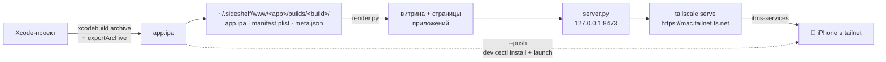

<div align="center">

# 📲 Sideshelf

**Личный App Store для своих iOS-приложений.**
Одна команда собирает Xcode-проект и кладёт его на твой iPhone: по воздуху, из любой точки tailnet.


</div>

---

```console
$ ota-deploy.sh --push
Building Semafor (com.sketchpiece.semafor) build 20261003.125425...
Exported Semafor to: build/ota-deploy/export
Published: https://my-mac.tailnet.ts.net/semafor/
Installed and launched on device C0F30EBA-…
```

Без TestFlight, без ревью, без ad-hoc профилей и без кабеля. Открыл страницу на телефоне,
нажал «Установить», готово. А если Mac видит айфон, приложение само ставится и запускается.

## ✨ Что умеет

- **Сборка одной командой.** `archive` → `export` с development-подписью и автоматическим провиженингом.
- **Всегда новая версия.** Номер билда это метка времени `YYYYMMDD.HHMMSS`, iOS не откажется обновлять.
- **Установка по воздуху.** Страница с `itms-services://` ссылкой и настоящим HTTPS-сертификатом от Tailscale.
- **Приватно.** Страница видна только устройствам в твоём tailnet, наружу ничего не торчит.
- **Витрина в духе App Store.** Свежая сборка сверху, ниже все приложения; у каждого своя страница со светлой и тёмной темой.
- **История сборок, как в TestFlight.** Хранятся последние 10 сборок, любую можно поставить обратно.
- **«Что нового» из git.** Под каждой сборкой коммиты, сделанные в папке проекта после предыдущей публикации.
- **С компьютера ведёт на телефон.** На десктопе вместо кнопок установки QR-код страницы.
- **PWA на домашний экран.** «Поделиться → На экран „Домой“» в Safari, и Sideshelf открывается как приложение, с переходами как в iOS.
- **Знает, что стоит на телефоне.** Mac спрашивает iPhone через `devicectl`: кнопка становится «Открыть» (и запускает приложение на телефоне), «Обновить» или «Установить», а в истории видно, какая сборка сейчас на телефоне. Работает, когда iPhone в одной Wi-Fi с Mac или на кабеле.
- **Русский и английский.** Язык страниц выбирается по языку системы телефона.
- **Без белого экрана.** Если Tailscale выключен или Mac спит, откроется подсказка «Включи Tailscale», и полка сама вернётся, как только Mac появится.
- **`--push`.** Если айфон рядом (кабель или та же Wi-Fi), ставит и запускает через `devicectl`, ни одного тапа.
- **Скилл для Claude Code.** Скажи «залей на телефон», и Claude соберёт и пришлёт ссылку.

## 🧭 Как это устроено



Tailscale из App Store на macOS живёт в песочнице и не умеет раздавать папки, поэтому файлы отдаёт
локальный сервер, а `tailscale serve` только проксирует его наружу с валидным сертификатом
(без настоящего HTTPS iOS установку по воздуху не разрешит).

## 🚀 Быстрый старт

**Нужно:** macOS с Xcode, аккаунт Apple Developer, Tailscale на Mac и на iPhone, включённые
[HTTPS-сертификаты](https://tailscale.com/kb/1153/enabling-https) в tailnet, айфон уже в dev-профиле
(достаточно один раз запустить на нём что-нибудь из Xcode).

```bash
git clone git@github.com:SketchPiece/Sideshelf.git
ln -s "$PWD/Sideshelf/skill" ~/.claude/skills/sideshelf   # подключить скилл к Claude Code
```

Дальше из папки любого проекта с `.xcodeproj` / `.xcworkspace`:

```bash
~/.claude/skills/sideshelf/scripts/ota-deploy.sh [--scheme NAME] [--project X.xcodeproj | --workspace X.xcworkspace] [--push]
```

| Флаг | Что делает | По умолчанию |
|---|---|---|
| `--scheme NAME` | какую схему собирать | первая схема проекта |
| `--project` / `--workspace` | явный путь к контейнеру | автопоиск, workspace в приоритете |
| `--push` | поставить и запустить на подключённом iPhone | выкл |

Или просто скажи Claude Code: *«залей на телефон»*.

## 🗂 Структура

```
skill/
├── SKILL.md              # инструкция для Claude Code: когда и как запускать, разбор проблем
└── scripts/
    ├── ota-deploy.sh     # сборка, экспорт, история сборок, раздача
    ├── render.py         # витрина и страницы приложений из meta.json
    ├── server.py         # раздача файлов + что стоит на iPhone и запуск приложений
    ├── sideshelf.css/.js # стили, анимации переходов, относительное время, QR на десктопе
    └── sw.js, offline.html, manifest.webmanifest, icon-*.png  # PWA и офлайн-страница
```

Данные раздачи лежат в `~/.sideshelf/www/<app>/builds/<build>/` (сколько хранить: `SIDESHELF_KEEP`, по умолчанию 10), лог сервера в `~/.sideshelf/http.log`.

## 🩺 Если что-то не так

| Симптом | Что проверить |
|---|---|
| Тап по «Установить» ничего не делает | открой страницу в самом Safari; в `http.log` должен быть запрос `manifest.plist` |
| Манифест скачался, `.ipa` нет | bundle id или URL в манифесте не совпадают |
| «Невозможно установить» | айфона нет в профиле: запусти разок из Xcode с подключённым телефоном |
| `tailscale serve failed` | в tailnet не включены Serve/HTTPS |
| После перезагрузки страница не открывается | просто запусти скрипт ещё раз, он поднимет сервер |

Остановить раздачу: `tailscale serve --https=443 off && kill $(cat ~/.sideshelf/server.pid)`.

## ⚠️ Ограничения

- Development-подпись: только устройства из профиля аккаунта (до 100 iPhone в год), профиль живёт около года.
- Автообновлений нет, за новой версией надо зайти на страницу (или использовать `--push`).
- Что стоит на телефоне, видно только когда Mac может достучаться до iPhone (одна Wi-Fi или кабель); иначе кнопка просто «Установить». Запуск через Mac занимает несколько секунд.
- Mac должен быть включён и в сети.

## 🛣 Идеи

- [x] Иконки приложений на витрине
- [x] История версий и откат
- [ ] Уведомление на телефон о новой сборке
